<p align="center">
  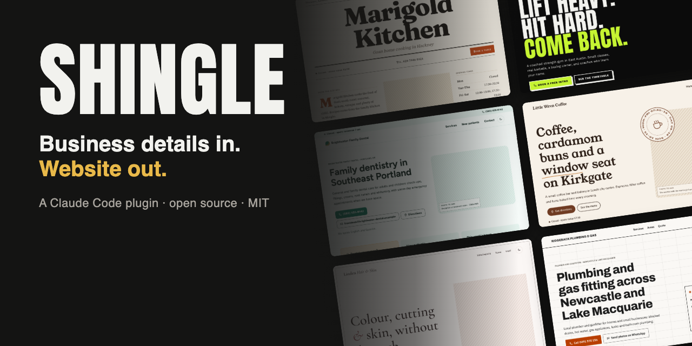
</p>

<h1 align="center">Shingle</h1>

<p align="center"><strong>Business details in. Website out.</strong><br>
A Claude Code plugin that interviews you about a local business and builds a distinctive,
accessible, production-ready website, with no lorem ipsum and nothing made up.</p>

<p align="center">
  <a href="https://github.com/OneLab-X/shingle/actions/workflows/ci.yml"></a>
  <a href="LICENSE"></a>
  <a href="https://onelab-x.github.io/shingle/"></a>
</p>

<p align="center">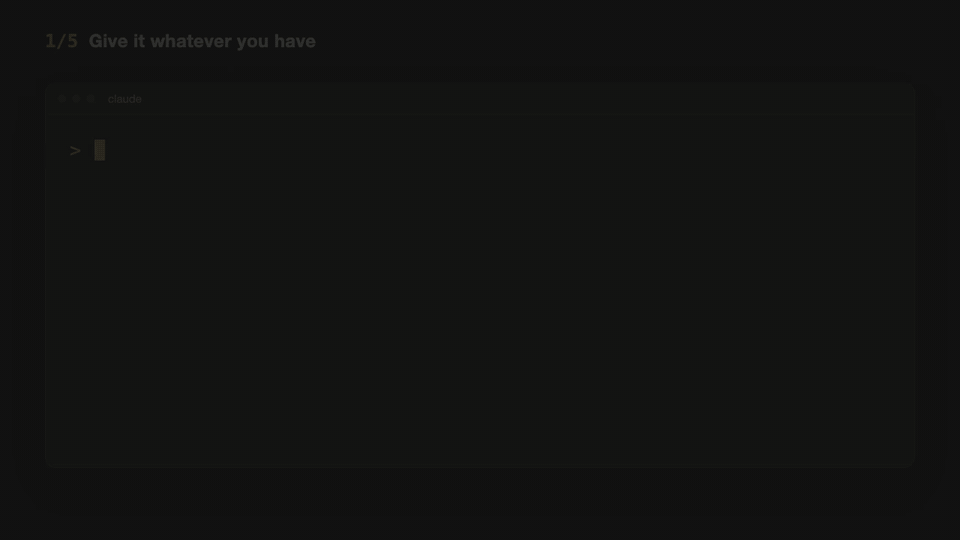</p>
<p align="center"><sub>Condensed, 20 seconds. The Claude Code screens are re-created for clarity; the script output and the site are real. <a href="docs/demo-video/">How it's made</a> · <a href="docs/media/demo.mp4">MP4</a></sub></p>

## Install

In Claude Code:

```
/plugin marketplace add OneLab-X/shingle
/plugin install shingle@shingle
```

## Quickstart

Give it whatever you have: a name and a phone number is enough to start.

```
/shingle Marigold Kitchen, Goan restaurant, 27 Fenwick Lane London E8 4QT,
020 7946 0321, hello@marigold-kitchen.example, Tue-Thu 5:30pm-10:30pm, Fri-Sat 12-3pm & 5:30pm-11pm
```

or point it at a file: `/shingle ./business.json`

Shingle then:

1. **Reads and normalizes** your details (or imports your Google Business Profile export) (phone to E.164, free-text hours to a schedule, country codes, socials) and tells you what is missing.
2. **Picks the closest category** of 13 (restaurant, dental clinic, plumber…) and loads only that playbook.
3. **Interviews you** with a few multiple-choice rounds (max 4 questions, a recommended answer each): goal, pages, tone, photos, booking, features.
4. **Proposes 2–3 palettes and a design direction**, all checked for WCAG AA contrast.
5. **Builds an Astro + Tailwind site** (one copy per language if you list several) with real copy from your facts, LocalBusiness JSON-LD, Open Graph, sitemap, robots, favicon, dark mode, and contact links that work without a backend.
6. **Audits it** (broken links, alt text, meta tags, JSON-LD and NAP consistency, fake reviews, lorem ipsum, emoji icons, purple gradients…), fixes what it finds, and starts a preview.
7. **Hands over**: decisions made, every placeholder still to fill (file:line), and one-command deploys to GitHub Pages, Netlify or Cloudflare Pages.

Re-run `/shingle` after editing `business.json` and it updates the site **without overwriting your hand edits**.

## Gallery

Nine fictional businesses (one of them bilingual), eight design directions. Every one was generated from a short `business.json`, and CI rebuilds and audits all of them on every pull request.

| | | |
|---|---|---|
| [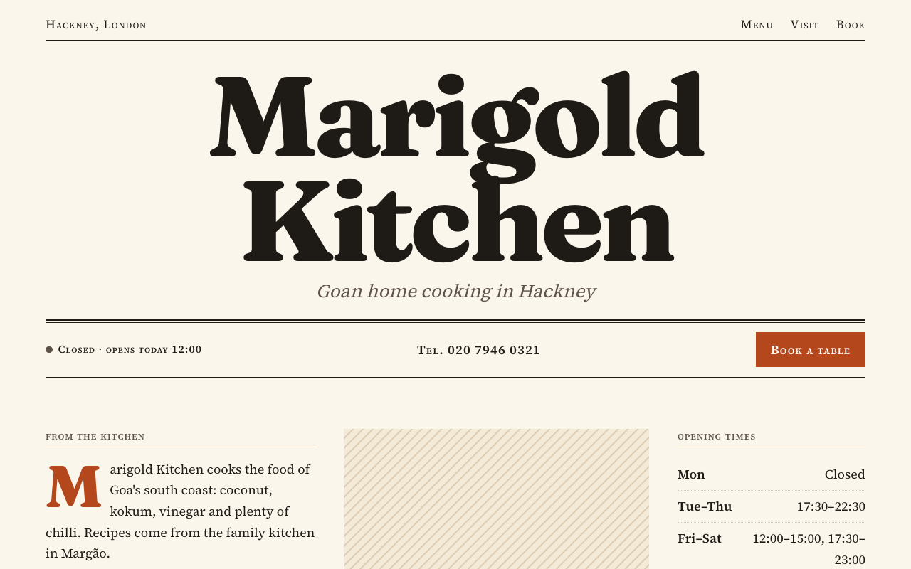](https://onelab-x.github.io/shingle/examples/marigold-kitchen/)<br>**[Marigold Kitchen](examples/marigold-kitchen/)** · restaurant · Broadsheet | [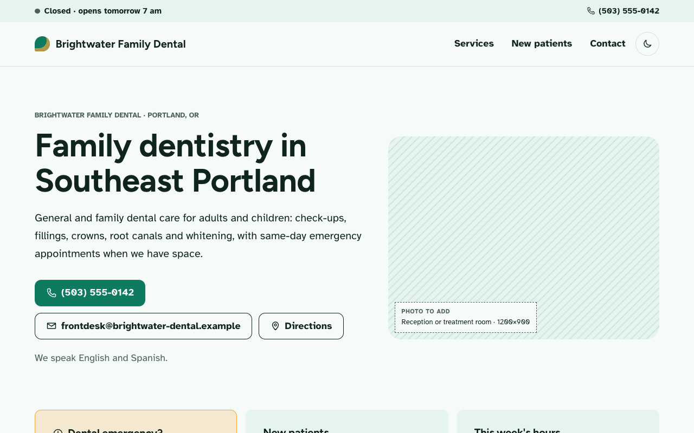](https://onelab-x.github.io/shingle/examples/brightwater-dental/)<br>**[Brightwater Family Dental](examples/brightwater-dental/)** · dental clinic · Clinical Calm | [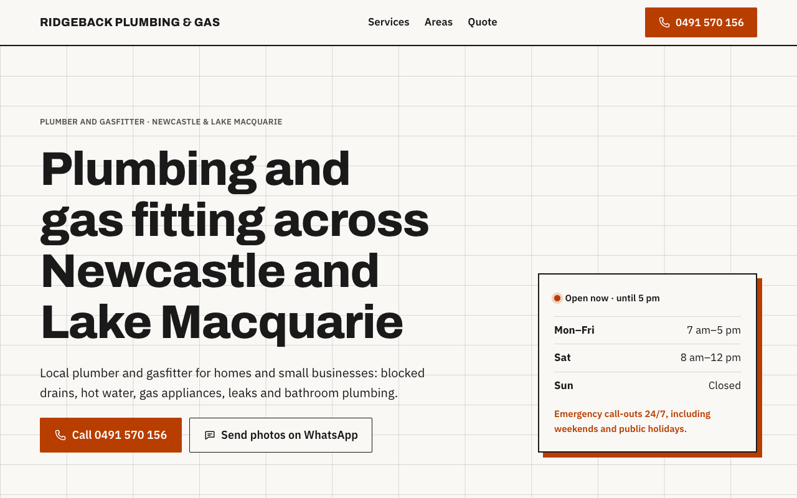](https://onelab-x.github.io/shingle/examples/ridgeback-plumbing/)<br>**[Ridgeback Plumbing & Gas](examples/ridgeback-plumbing/)** · plumber · Swiss Grid |
| [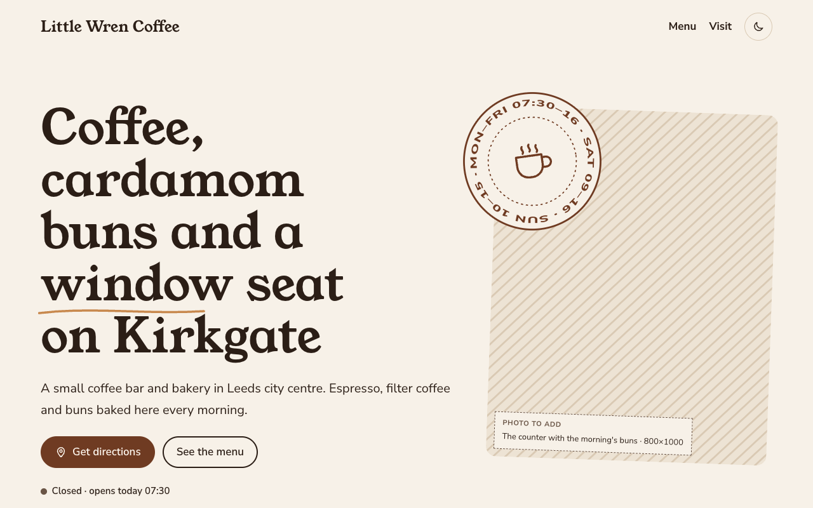](https://onelab-x.github.io/shingle/examples/little-wren-coffee/)<br>**[Little Wren Coffee](examples/little-wren-coffee/)** · cafe · Handmade | [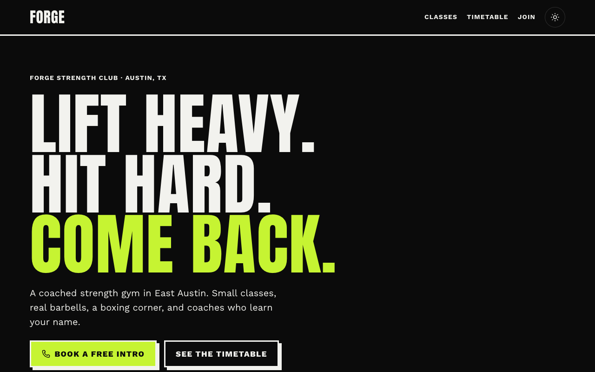](https://onelab-x.github.io/shingle/examples/forge-strength/)<br>**[Forge Strength Club](examples/forge-strength/)** · gym · Poster | [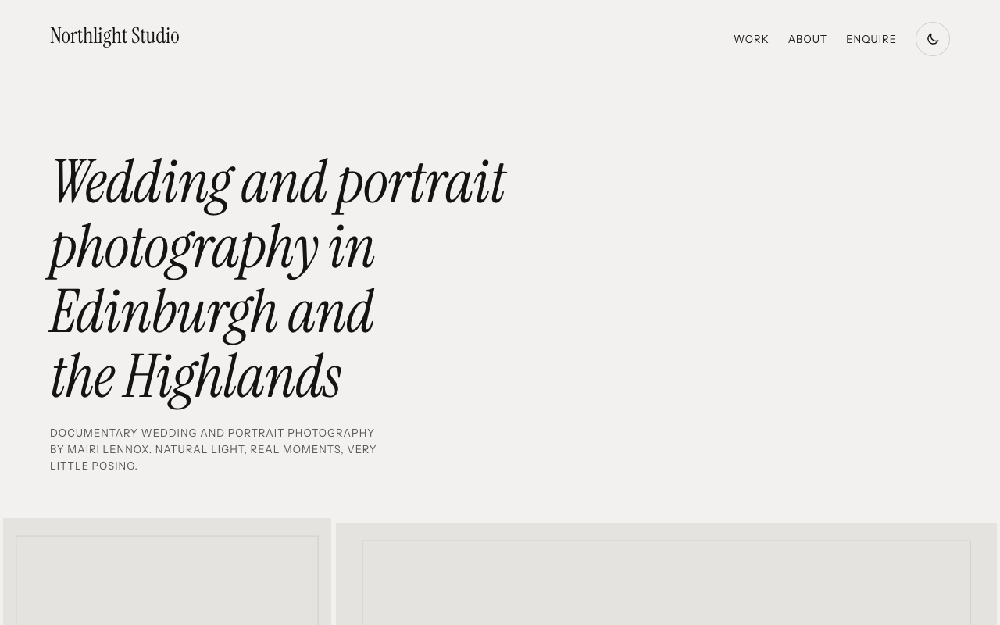](https://onelab-x.github.io/shingle/examples/northlight-studio/)<br>**[Northlight Studio](examples/northlight-studio/)** · photographer · Gallery |
| [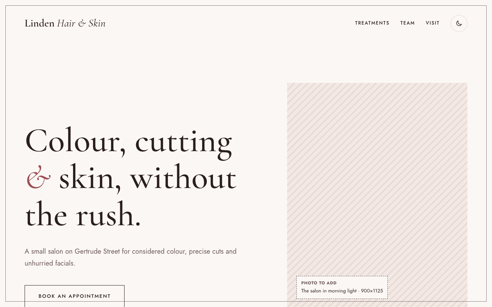](https://onelab-x.github.io/shingle/examples/linden-hair/)<br>**[Linden Hair & Skin](examples/linden-hair/)** · salon · Quiet Luxury | [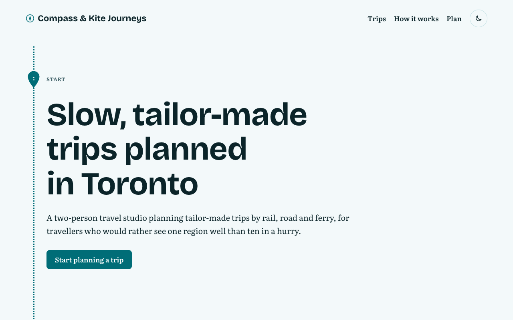](https://onelab-x.github.io/shingle/examples/compass-kite/)<br>**[Compass & Kite Journeys](examples/compass-kite/)** · travel agency · Wayfinder | [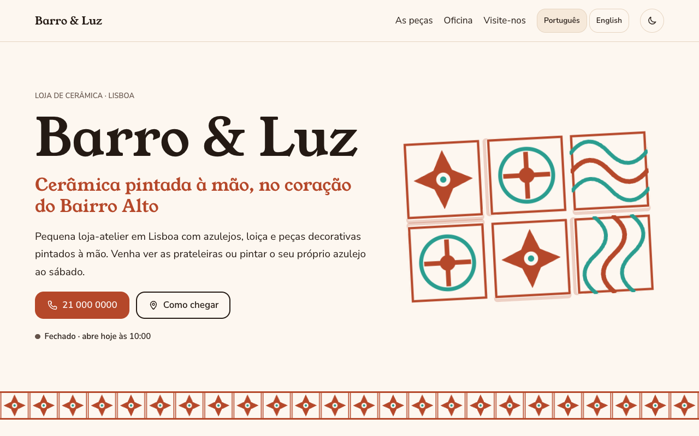](https://onelab-x.github.io/shingle/examples/barro-e-luz/)<br>**[Barro & Luz](examples/barro-e-luz/)** · ceramics shop · Handmade · **pt + en** |

Each example's README explains its design choices and lists the placeholders the owner still needs to fill.

## What makes it different

- **Nothing is invented.** Reviews, awards, prices, years in business, team members, licence numbers and statistics only appear if you provide them. Everything else becomes a visible, audited `TODO(shingle)` placeholder.
- **Not another template.** Eight design directions, each with its own type pairing, spacing, shape language and a signature element (a newspaper masthead, an hours stamp, a route line, oversized numerals…), plus an explicit anti-slop list: no default purple gradients, no hero + three cards, no emoji icons, no stock photos.
- **Local SEO done properly.** schema.org type per category, opening hours, NAP consistency checks, Open Graph cards rendered at build time, sitemap and robots.
- **Accessible by default.** WCAG AA palettes (checked by script), skip links, labelled forms, focus states, reduced-motion support, light and dark modes.
- **Yours.** A plain Astro project with no lock-in and no runtime dependencies. Host it anywhere static, usually for free.

## Categories

`restaurant` · `cafe` · `dental-clinic` · `law-firm` · `salon-spa` · `gym-fitness` · `real-estate` · `travel-agency` · `photographer` · `contractor-home-services` · `ecommerce-boutique` · `nonprofit` · `generic-local-business`

Each category is one short Markdown playbook: audience, tone, required sections, questions to ask, schema type, imagery guidance and a list of things to never invent. [Add one in under 10 minutes →](docs/adding-a-category.md)

## FAQ

**Do I need to know how to code?** No. You answer questions in Claude Code; Shingle writes, builds and checks the site, then gives you a one-command deploy.

**What does it cost?** The plugin is free and MIT-licensed. You need Claude Code. Hosting on GitHub Pages, Netlify or Cloudflare Pages is free for sites like these; a domain costs whatever your registrar charges.

**Can it make things up to fill space?** It is told not to, and `audit_site.py` checks for fabricated review markup, NAP mismatches and filler copy. Unknowns become placeholders you can see and fill.

**Where do the photos come from?** Only from you. Until you add them, the site shows labelled placeholders sized for the real photo. Shingle never hotlinks or generates photos of your business.

**Does it need a server, database or form backend?** No. Contact works with phone, WhatsApp and email links, and an optional form service (Formspree, Web3Forms or Netlify Forms).

**Can I edit the site afterwards?** Yes, it is a normal Astro project. Shingle records a hash of every file it generated, so re-running it never overwrites your edits; it saves its proposed version next to yours instead.

**Which Node and Python versions?** Node 22.23.4+ (Astro 7) for the site. The helper scripts use only the Python 3.9+ standard library.

**Can I import my Google Business Profile?** Yes: `/shingle ./locations.csv` (or `.tsv`, `.xlsx`, or an API `Location` `.json`). Download it in Business Profile Manager: Actions > Download > Businesses. Shingle fills the name, address, phone, hours, website, category and description, never overwrites what you already wrote, and lists what it skipped. Reviews, ratings and photos are never imported. See [the guide](skills/shingle/references/google-business-profile.md).

**Can the site be in two languages?** Yes. List them in `languages` (the first is the default) and Shingle builds `/pt/`, `/en/` and so on with hreflang, a language switcher and translated interface text (en, pt, es, fr, de, it; others fall back to English). Claude drafts the translations from your facts and the site shows a visible "native speaker should review this" notice until you mark them reviewed. Prices, phone numbers and names are never translated. [Example](examples/barro-e-luz/).

**Can it do online stores or bookings?** It links to the shop or booking tool you already use (Shopify, Square, Calendly…). It does not build carts or take payments.

## Roadmap

- [x] Multi-language sites (`/en/`, `/pt/`) with hreflang, driven by `languages`
- [ ] Right-to-left languages (Arabic, Hebrew)
- [ ] Optional "suggest my language" banner (no automatic redirect, which hurts SEO)
- [x] Import from a Google Business Profile export (spreadsheet download or API JSON)
- [ ] More categories: vet, accountant, florist, driving school, coworking
- [ ] More design directions and palettes from the community
- [ ] Optional blog/news collection with RSS
- [ ] Image pipeline: drop a folder of photos, get alt text suggestions to confirm

## Contributing

Categories, palettes and design directions are the easiest and most valuable contributions. See [CONTRIBUTING.md](CONTRIBUTING.md) and [docs/adding-a-category.md](docs/adding-a-category.md).

## License

[MIT](LICENSE). Example businesses are fictional; their phone numbers come from ranges reserved for fiction.
